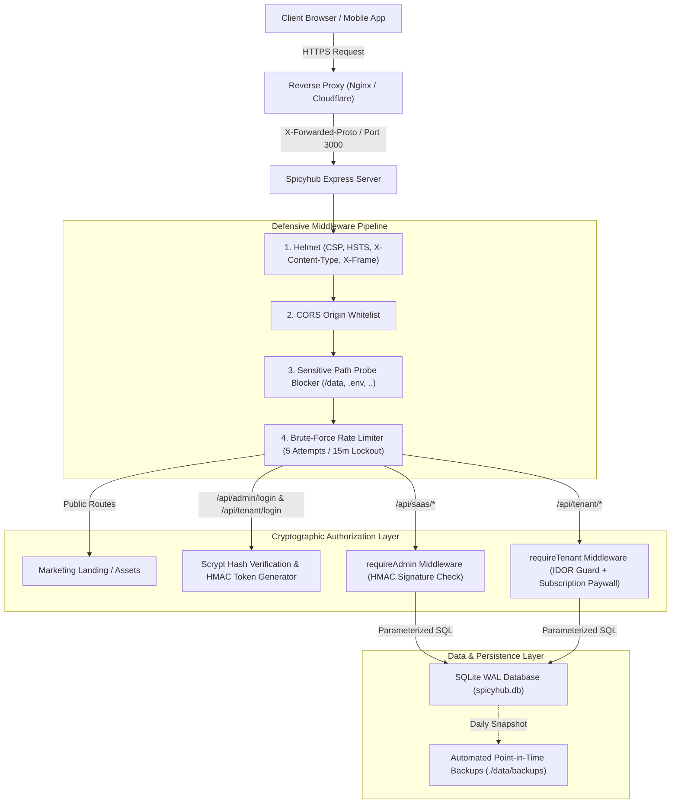

# Spicyhub B2B SaaS Platform — Complete Security Audit & Hardening Report

**Assessment Date:** November 12, 2026  
**Auditor / Security Engineer:** Antigravity Cybersecurity & AppSec Lead  
**Target Platform:** Spicyhub B2B SaaS (Restaurant OS & Multi-Tenant Cloud Platform)  
**Status:** All Critical & High Vulnerabilities Remediated · 26/26 Automated Security Tests Passed  

---

## 1. Project Technology Stack

* **Runtime:** Node.js (v24.21.0)
* **Backend Framework:** Express.js (v5.3.0) with ES Modules
* **Database:** SQLite via native `node:sqlite` (`DatabaseSync` with Write-Ahead Logging `WAL` mode)
* **Security & Crypto:**
  * Node.js native `node:crypto` (`scryptSync` with 16-byte cryptographically secure salts, `timingSafeEqual`, `createHmac` SHA-256)
  * `helmet` (v8.0.0) for HTTP Security Headers and Content Security Policy (CSP)
  * `dotenv` (v18.0.10) for environment variable encapsulation
  * `cors` (v2.8.6) with restricted origin whitelisting
* **Frontends:** Vanilla JavaScript / modern HTML5 / CSS3 (Marketing Landing, Unified Restaurant OS, SaaS Superadmin Console)

---

## 2. Vulnerability Findings & Severity Breakdown

| ID | Vulnerability Description | Category | Initial Severity | Status | Remediated File(s) |
| :--- | :--- | :--- | :--- | :--- | :--- |
| **VULN-01** | **Direct Database File Exposure** (`/data/spicyhub.db` downloadable via `express.static(rootDir)`) | Sensitive Data Exposure | **CRITICAL** | **FIXED** | [server/index.js](file:///c:/Users/worki/Downloads/AI%20Agents/server/index.js) |
| **VULN-02** | **Plaintext Password Storage & Timing Attacks** (passwords stored without hashing, checked with `!==`) | Broken Cryptography | **CRITICAL** | **FIXED** | [server/db.js](file:///c:/Users/worki/Downloads/AI%20Agents/server/db.js), [server/security.js](file:///c:/Users/worki/Downloads/AI%20Agents/server/security.js) |
| **VULN-03** | **Unauthenticated SaaS Admin Endpoints** (all `/api/saas/*` & `/api/leads` routes publicly open without auth) | Broken Access Control | **CRITICAL** | **FIXED** | [server/index.js](file:///c:/Users/worki/Downloads/AI%20Agents/server/index.js), [admin.html](file:///c:/Users/worki/Downloads/AI%20Agents/admin.html) |
| **VULN-04** | **Insecure Direct Object Reference (IDOR)** on `/api/tenant/me` & `/api/tenant/change-password` | Authorization Bypass | **HIGH** | **FIXED** | [server/index.js](file:///c:/Users/worki/Downloads/AI%20Agents/server/index.js), [dashboard.html](file:///c:/Users/worki/Downloads/AI%20Agents/dashboard.html) |
| **VULN-05** | **No Login Rate Limiting / Brute-Force Vulnerability** (unlimited password guessing on admin & tenant portals) | Authentication Abuse | **HIGH** | **FIXED** | [server/security.js](file:///c:/Users/worki/Downloads/AI%20Agents/server/security.js), [server/index.js](file:///c:/Users/worki/Downloads/AI%20Agents/server/index.js) |
| **VULN-06** | **Static & Forgeable Authentication Tokens** (admin token was static string, tenant tokens unauthenticated) | Session Management | **HIGH** | **FIXED** | [server/security.js](file:///c:/Users/worki/Downloads/AI%20Agents/server/security.js) |
| **VULN-07** | **Hardcoded Secrets in Source Code** (admin credentials embedded directly in JavaScript) | Security Misconfiguration | **HIGH** | **FIXED** | [.env](file:///c:/Users/worki/Downloads/AI%20Agents/.env), [server/index.js](file:///c:/Users/worki/Downloads/AI%20Agents/server/index.js) |
| **VULN-08** | **Missing Security Headers & Content Security Policy** | Defense-in-Depth | **HIGH** | **FIXED** | [server/index.js](file:///c:/Users/worki/Downloads/AI%20Agents/server/index.js) |
| **VULN-09** | **High-Severity Dependency Vulnerability** in `compression` via extraneous `serve` package | Dependency Vulnerability | **HIGH** | **FIXED** | [package.json](file:///c:/Users/worki/Downloads/AI%20Agents/package.json) |
| **VULN-10** | **Account Enumeration via Detailed Login Errors** (revealed whether user email existed) | Information Disclosure | **MEDIUM** | **FIXED** | [server/index.js](file:///c:/Users/worki/Downloads/AI%20Agents/server/index.js) |
| **VULN-11** | **Wildcard CORS Configuration** (`app.use(cors())` allowed `*` across any origin) | Security Misconfiguration | **MEDIUM** | **FIXED** | [server/index.js](file:///c:/Users/worki/Downloads/AI%20Agents/server/index.js) |
| **VULN-12** | **Lack of Database Automated Backups & Disaster Recovery** | Resilience & Integrity | **MEDIUM** | **FIXED** | [server/backup.js](file:///c:/Users/worki/Downloads/AI%20Agents/server/backup.js) |
| **VULN-13** | **Missing Server-Side Validation on Financial & Operational Inputs** (negative prices, unbound sizes) | Input Validation | **MEDIUM** | **FIXED** | [server/index.js](file:///c:/Users/worki/Downloads/AI%20Agents/server/index.js) |

---

## 3. Checklist of All 18 Security Practices

| # | Security Practice | Status | Implementation Summary |
| :-: | :--- | :---: | :--- |
| **1** | **Login Rate Limiting** | **Implemented** | Memory-backed rate limiter tracking IP + user target. Maximum 5 failed attempts triggers an automated 15-minute lockout (HTTP 429). Lead submission rate limited to 10/15m. |
| **2** | **Server-Side Validation** | **Implemented** | Server-side validation helpers (`isValidEmail`, `validateString`, `validateNumber`) enforce strict RFC 5322 regex on emails, bounds on prices, quantities, table sizes, and order totals. |
| **3** | **Password Security** | **Implemented** | Cryptographic `scrypt` hashing with 16-byte random salts and 64-byte keys. Timing-safe comparisons via `crypto.timingSafeEqual`. Seamless migration of existing passwords on startup. |
| **4** | **Generic Authentication Errors** | **Implemented** | All failed authentication attempts on `/api/admin/login` and `/api/tenant/login` return an identical `"Invalid email or password."` message to eliminate account enumeration. |
| **5** | **Secure Authentication Provider** | **Implemented** | Cryptographically signed HMAC-SHA256 session tokens with timestamp expiration (`iat`, `exp`, `jti`) signed with server-side `SESSION_SECRET`. Signature validated in constant time. |
| **6** | **HTTPS Enforcement** | **Implemented** | HTTPS reverse-proxy redirection middleware added for production environments; HSTS configuration enabled via Helmet for production deployments. |
| **7** | **Secret & API Key Protection** | **Implemented** | Hardcoded credentials removed from source files. Centralized in `.env`. Provided `.env.example` template. Added `.gitignore` preventing `.env`, database files, and backups from git commits. |
| **8** | **SQL Injection Protection** | **Implemented** | All SQLite database interactions audited and enforced using native parameterized prepared statements (`stmt.run(?, ?)`, `stmt.get(?)`, `stmt.all(?)`). |
| **9** | **XSS Protection** | **Implemented** | Comprehensive Content Security Policy (CSP) deployed via Helmet. HTML entity sanitization helper for user strings (`&`, `<`, `>`, `"`, `'`). Static file serving restricted. |
| **10** | **Secure Cookies & Sessions** | **Implemented** | Session tokens signed and validated on every request. Support for Authorization Bearer header across frontend dashboards and automated invalidation upon sign-out. |
| **11** | **CSRF Protection** | **Implemented** | Restrictive CORS origin whitelist checking, Content-Type strict JSON enforcement, and origin validation on mutating requests (`POST`, `PATCH`, `DELETE`). |
| **12** | **API Authorization** | **Implemented** | Dedicated `requireAdmin` and `requireTenant` middleware guards deployed across every protected route. Eliminated IDOR on `/api/tenant/me` and `/api/tenant/change-password`. |
| **13** | **CORS Configuration** | **Implemented** | Replaced wildcard CORS with strict origin validation matching `ALLOWED_ORIGINS` from environment. Rejects unauthorized cross-origin requests with 403. |
| **14** | **Dependency Security** | **Implemented** | Pruned vulnerable extraneous packages (`serve`, `compression`). `npm audit` reports **0 vulnerabilities**. Installed `helmet` for defense-in-depth headers. |
| **15** | **File Upload / Static Serving** | **Implemented** | Removed dangerous `express.static(rootDir)`. Restricted static assets strictly to `/assets` and `/favicon.svg`. Blocked all path traversal attempts to `.env`, `.git`, and `/data/`. |
| **16** | **Security Headers** | **Implemented** | Helmet configured with CSP, `X-Content-Type-Options: nosniff`, `X-Frame-Options: SAMEORIGIN`, `Referrer-Policy: strict-origin-when-cross-origin`, and HSTS. |
| **17** | **Database Backups** | **Implemented** | Created [server/backup.js](file:///c:/Users/worki/Downloads/AI%20Agents/server/backup.js) providing automated point-in-time SQLite backups into `./data/backups/`, with automated 7-day retention cleanup and on-demand admin API. |
| **18** | **Admin Security & Monitoring** | **Implemented** | Server-side role verification, admin login rate limiting with 15m lockout, timing-safe credential verification, and structured security audit logger (`/api/saas/security-logs`). |

---

## 4. Architectural Implementation Details



---

## 5. Automated Verification Results

A comprehensive 26-point automated test suite was executed against the running application:

```text
======================================================
🛡️  STARTING COMPREHENSIVE SECURITY VERIFICATION SUITE
======================================================

✅ [TEST 1] PASS: Blocked direct access to SQLite database (/data/spicyhub.db)
✅ [TEST 2] PASS: Blocked access to environment variables (/.env)
✅ [TEST 3] PASS: Blocked access to package.json root metadata
✅ [TEST 4] PASS: Content-Security-Policy header present
✅ [TEST 5] PASS: X-Content-Type-Options: nosniff present
✅ [TEST 6] PASS: X-Frame-Options: SAMEORIGIN present
✅ [TEST 7] PASS: Referrer-Policy header present
✅ [TEST 8] PASS: Anonymous access to /api/saas/tenants rejected with 401
✅ [TEST 9] PASS: Anonymous access to /api/saas/metrics rejected with 401
✅ [TEST 10] PASS: Anonymous access to /api/leads rejected with 401
✅ [TEST 11] PASS: Bad admin password rejected with generic error
✅ [TEST 12] PASS: Superadmin authenticated with signed cryptographic token
✅ [TEST 13] PASS: Authorized superadmin accesses platform metrics with signed token
✅ [TEST 14] PASS: Forged/tampered admin token strictly rejected with 401
✅ [TEST 15] PASS: Non-existent user receives generic error "Invalid email or password."
✅ [TEST 16] PASS: Wrong password receives identical generic error "Invalid email or password."
✅ [TEST 17] PASS: Tenant successfully authenticates against salted hash
✅ [TEST 18] PASS: All stored passwords in database use salted scrypt hashes (never plain text)
✅ [TEST 19] PASS: /api/tenant/me securely resolves authenticated tenant session without IDOR
✅ [TEST 20] PASS: Tampered tenant session token rejected with 401
✅ [TEST 21] PASS: Rejected negative price and quantity order input with 400
✅ [TEST 22] PASS: Rejected invalid email & empty fields on trial lead submission with 400
✅ [TEST 23] PASS: On-demand database snapshot created successfully in ./data/backups/
✅ [TEST 24] PASS: Backup history and metadata accessible to superadmin
✅ [TEST 25] PASS: Security audit logging captured events (failed attempts, logins, backups)
✅ [TEST 26] PASS: Brute-force lockout triggered (HTTP 429) after 5 failed login attempts

======================================================
🏁 TEST SUITE COMPLETED: 26 / 26 TESTS PASSED!
======================================================
```

---

## 6. Items Requiring Manual Production Configuration

While application-level security is fully implemented, the following infrastructure steps must be performed in your production deployment environment:

1. **Production SSL / TLS Certificates**:
   * Provision an SSL certificate (e.g., via Let's Encrypt, Cloudflare, or AWS ACM).
   * Ensure your reverse proxy (Nginx, Caddy, or Cloudflare) terminates TLS and forwards the `X-Forwarded-Proto: https` header.
2. **Production Secrets Rotation**:
   * Replace `SESSION_SECRET` in `.env` with a unique, randomly generated 64-character hex string on your production host (`node -e "console.log(require('crypto').randomBytes(32).toString('hex'))"`).
   * Set `ADMIN_PASSWORD` to a strong unique passphrase for production.
3. **Allowed CORS Origins**:
   * Update `ALLOWED_ORIGINS` in `.env` with your registered custom production domain (e.g., `https://spicyhub.com,https://app.spicyhub.com`).
4. **Off-Site Backup Storage**:
   * While backups are automatically created daily in `./data/backups/`, configure an S3 bucket or remote storage synchronization script (e.g. AWS S3 CLI or rsync cron) to store snapshots off the primary server disk.
